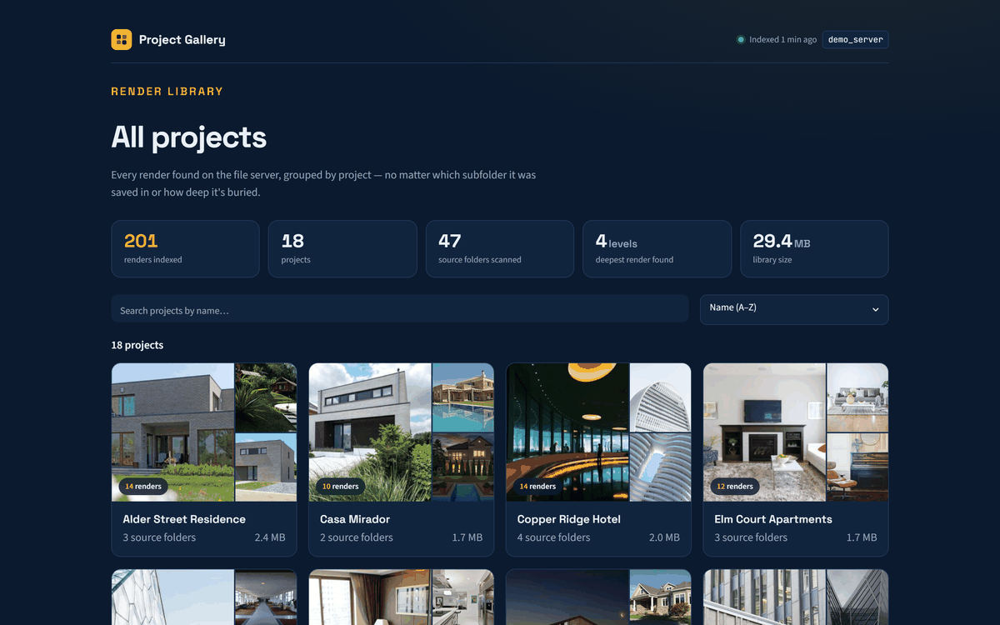
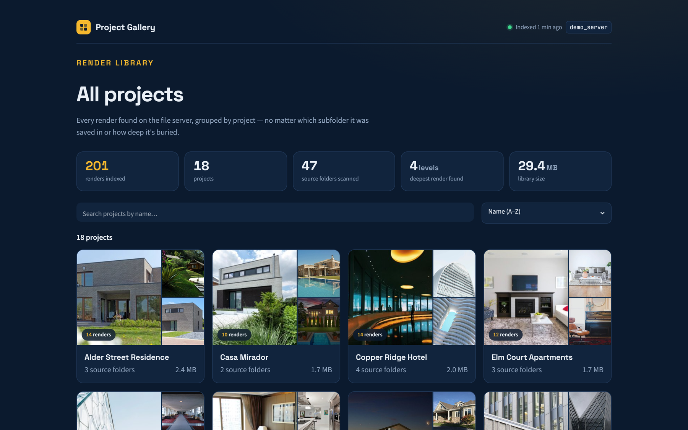
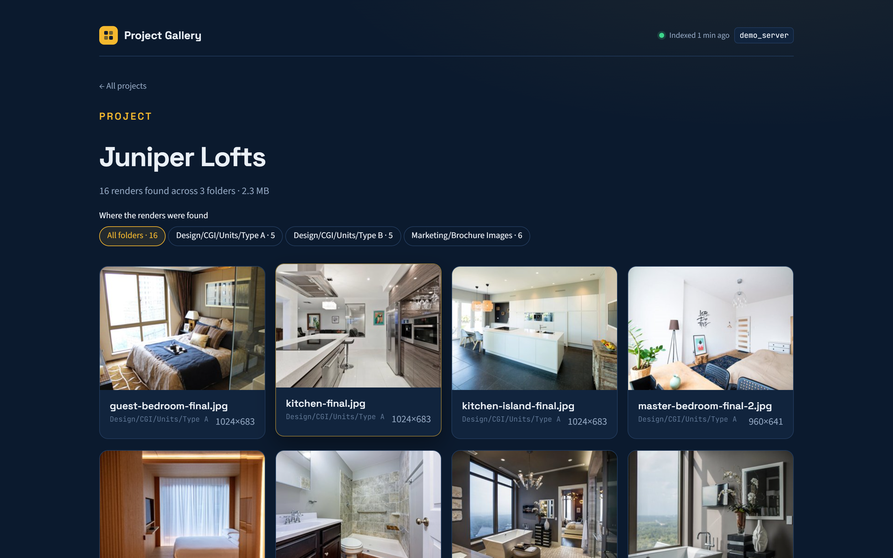
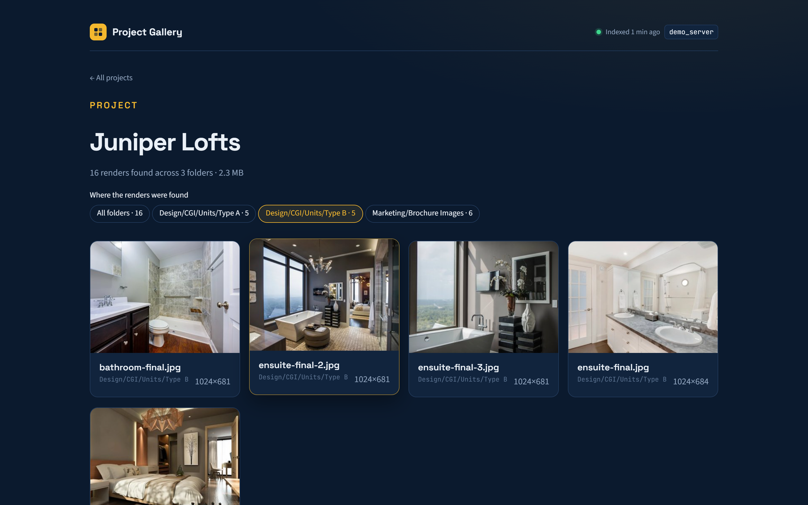
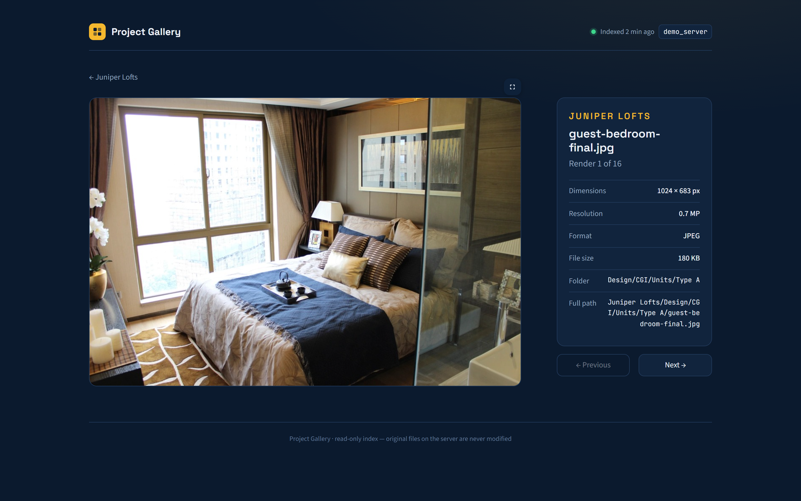

# Project Gallery

Turn a messy file server into a searchable visual catalog of renders.

[](https://github.com/EnzoJF24/Project-Galery/actions/workflows/tests.yml)
[](https://www.python.org/)
[](LICENSE)

Architecture and design studios end up with hundreds of project folders on
a shared drive, and every team files its renders differently:
`03_Renders/Final`, `Visualization/Interior/Lobby`, `RENDERS/old`,
`Client Review 2024-05`... Finding "that kitchen render from the Juniper
job" means clicking through File Explorer folder by folder. Non-technical
staff (sales, marketing, management) usually just ask someone else.

Project Gallery scans the share once, indexes every render it finds (at any
depth, under any folder naming convention) into a local database, and serves
them as a fast, searchable web gallery grouped by project. Re-scans only
pick up what's new, so it stays current in seconds.



*The demo indexes 201 renders across 18 projects and 47 differently named
source folders, nested up to 4 levels deep. You can rebuild the same demo
server locally with one command (see [Try it with demo data](#try-it-with-demo-data)).*

## Features

- **Deep, structure-agnostic scanning** — finds images no matter how deep
  they're nested or what the containing folders are named.
- **Incremental re-scans** — re-running the scanner only processes images
  that weren't indexed before. Scanning a server with thousands of existing
  renders after adding a handful of new ones takes seconds, not minutes.
- **Resilient to a partial scan** — if a scan is interrupted, the next run
  picks up exactly where it left off, with no duplicate entries.
- **Robust to bad files** — a single corrupted image is logged and skipped,
  never aborting the whole scan.
- **Fast, indexed browsing** — the gallery reads only from a local SQLite
  index and pre-generated thumbnails, never the live filesystem, so it stays
  responsive regardless of how large the source directory is.
- **Library overview** — headline numbers for the whole index: renders,
  projects, source folders scanned, deepest render found, total size.
- **Search and sort projects** by name, by number of renders, or by most
  recently added.
- **"Where the renders were found"** — every project shows the folders its
  renders actually live in, and filters the grid to one folder with a click.
- **Detail view** with the full-resolution image, dimensions, resolution,
  format, file size and the original path, plus previous/next stepping
  through the project.
- **Polished UI** — a dark, image-first theme, whole-card click targets,
  hover micro-interactions, and proper empty states, built to feel like a
  real product rather than a default Streamlit app. Works on mobile too.
- **Optional shared-password protection**, configured without touching code.

## Screenshots

**Library.** Headline numbers for the whole index, and every project as a
card with a three-render preview.



**Project.** All of a project's renders, with the folders they were found in.



**Filtered by source folder.** One click narrows the grid to a single folder.



**Render detail.** Full-resolution image, metadata and original path.



## Architecture

The tool is a four-stage pipeline, each stage its own module:

```
   scan root
       |
       v
 1. Crawler (gallery/crawler.py)
    Walks each top-level folder ("project") recursively via os.walk,
    collecting every .jpg/.jpeg/.png at any depth.
       |
       v
 2. Processor (gallery/processor.py)
    Opens each new image with Pillow: reads metadata (dimensions, format,
    size), corrects EXIF rotation, and writes a thumbnail to disk.
    Corrupt files are logged and skipped.
       |
       v
 3. Index (gallery/index.py) — SQLite, WAL mode
    The single source of truth. Scanning writes here; the viewer only
    ever reads from here.
       |
       v
 4. Viewer (app.py) — Streamlit
    Reads exclusively from the index. Grid of projects, per-project
    pagination, search, and an image detail view.
```

`scan.py` (the CLI) drives stages 1-3. `app.py` (Streamlit) is stage 4 and
never touches the filesystem directly except to read already-generated
thumbnails and, when available, the original file for the full-resolution
detail view.

### Incremental scanning, and why it's correct

A project's identity is its folder path **relative to the scan root**
(e.g. `"Modern Villa"`), never an absolute path. An absolute path would
break the moment the root is mounted under a different drive letter or the
server folder is moved — every project would look "new" again. A bare
folder name without the relative-path context would break the moment two
different projects share a name.

The same principle applies one level down: an image's identity is its path
relative to its project, enforced with a `UNIQUE(project_id, rel_path)`
constraint in SQLite. This is what makes the incremental scan correct:

- Re-running a scan with no changes processes zero images.
- Dropping new renders into an **already-indexed** project is detected —
  the incremental check isn't limited to brand-new projects.
- A scan killed halfway through leaves partial progress in place; the next
  run picks up the remaining images without creating duplicates, because
  each image is committed as it's processed rather than all at once.

Nothing about "is this new?" ever depends on a scan timestamp or run ID —
only on stable filesystem structure.

## Requirements

- Python 3.11+
- Windows, macOS, or Linux (developed and tested on Windows)

## Installation

```bash
# 1. Clone the repository
git clone https://github.com/EnzoJF24/Project-Galery.git
cd Project-Galery

# 2. Create and activate a virtual environment
python -m venv .venv
.venv\Scripts\activate          # Windows
# source .venv/bin/activate     # macOS/Linux

# 3. Install dependencies
pip install -r requirements.txt
```

## Try it with demo data

Don't have a file server handy? Build a realistic one:

```bash
python scripts/make_demo_data.py
python scan.py --root demo_server
streamlit run app.py
```

The script downloads about 150 public-domain (CC0) architecture photos,
listed with their sources in `scripts/demo_manifest.json`. It arranges them
as 18 projects that each organize their renders differently, the same tree
used in the screenshots above. Running it again reuses the downloads.

## Usage

### 1. Scan a directory of projects

```bash
python scan.py --root "C:\path\to\your\projects"
```

Each direct subfolder of `--root` is treated as one project. Images can
live at any depth inside it.

Useful flags:

| Flag | Description |
|---|---|
| `--root` | **(Required)** Directory containing your project folders. |
| `--db` | Path to the SQLite database file (default: `gallery.db`). |
| `--thumbnails` | Directory for generated thumbnails (default: `thumbnails/`). |
| `--force` | Reprocess every image, even ones already indexed. |
| `--verbose` | Print each image as it's processed, not just the summary. |

Run it again any time — new projects and new images are picked up
automatically; nothing already indexed is reprocessed.

### 2. Launch the gallery

```bash
streamlit run app.py
```

This opens the app in your browser (usually at `http://localhost:8501`).
If you haven't run a scan yet, the app will tell you so.

### 3. (Optional) Password-protect the gallery

Copy `.streamlit/secrets.toml.example` to `.streamlit/secrets.toml` and set
your own password:

```toml
app_password = "your-password-here"
```

`secrets.toml` is gitignored and must never be committed. Without this
file, the app runs with no login prompt.

## Project structure

```
project-gallery/
├── app.py                   # Streamlit entry point (the viewer)
├── scan.py                  # CLI entry point (the scanner)
├── requirements.txt
├── scripts/
│   ├── make_demo_data.py    # Builds a realistic demo file server
│   └── demo_manifest.json   # CC0 photos used by the demo, with sources
├── .streamlit/
│   ├── config.toml          # Theming
│   └── secrets.toml.example # Auth template (copy to secrets.toml)
├── gallery/
│   ├── config.py            # Shared constants
│   ├── crawler.py           # Stage 1: filesystem discovery
│   ├── processor.py         # Stage 2: metadata + thumbnails
│   ├── index.py             # Stage 3: SQLite index
│   └── ui/
│       ├── auth.py          # Optional password gate
│       ├── components.py    # HTML cards, panels and formatting helpers
│       └── styles.py        # Injected CSS (theme, cards, layout)
└── tests/                   # pytest suite covering the pipeline
```

## Running the tests

```bash
pytest
```

## Future roadmap

Deliberately out of scope for this version, to keep it focused:

- Image deduplication (exact or perceptual hashing).
- AI-based auto-tagging / image recognition.
- In-app image editing.
- Multi-user accounts and roles.
- Always-on deployment / containerization.

## License

[MIT](LICENSE). Demo photos are public domain (CC0); see
`scripts/demo_manifest.json` for each photo's source.
